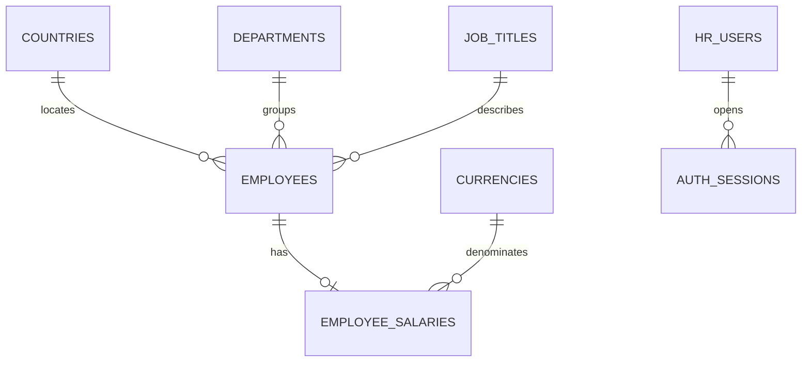
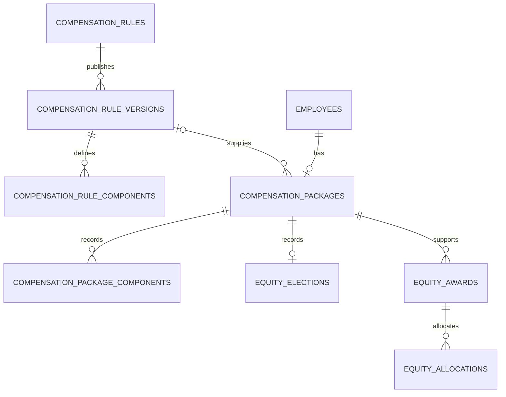
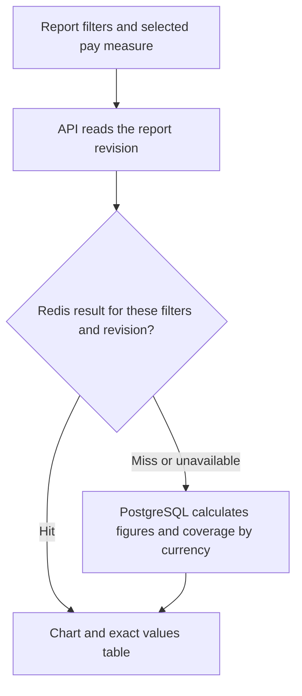

# PayScope database design guide

PayScope keeps a directory of employees and one current compensation package per employee. The package records annual pay and employer costs. Equity awards have their own year-by-year cost records. Salary Insights combines these records to answer questions like “How much does this team cost?” and “How does typical pay compare across countries?”

- [How the tables connect](#how-the-tables-connect)
- [One employee from offer letter to chart](#one-employee-from-offer-letter-to-chart)
- [How Salary Insights uses the data](#how-salary-insights-uses-the-data)
- [What happens when HR saves a change](#what-happens-when-hr-saves-a-change)
- [Read the schema and query an example](#read-the-schema-and-query-an-example)

## How the tables connect

PostgreSQL stores the records in the `app` schema. A **schema** is a named container for tables, so `app.employees` means the employees table inside `app`. Each **primary key** identifies a row, and a **foreign key** links that row to a valid record in another table. For example, `employees.department_id` points to `departments.id`.

### Employees and HR accounts



[View the employee and access diagram as an image](database-diagrams/01-employees-and-access.png)

Read `||` as “exactly one,” `o|` as “zero or one,” and `o{` as “zero or many.” An employee belongs to one department, a department can contain many employees, and an employee can have at most one legacy salary record. The directory uses an internal numeric `id` to join records. HR searches by the separately stored `employee_code`, such as `EMP-000001`.

| Tables | What they hold |
| --- | --- |
| `countries`, `departments`, `job_titles` | Shared choices for assigning and filtering employees. `IN` is a country code for India. |
| `currencies` | Shared currency codes. PayScope supports INR, USD, GBP, and EUR. The employee’s country and the package’s currency are separate fields. |
| `employees` | Employee identity and their current country, department, and job title. |
| `employee_salaries` | The original salary feature’s annual gross base amount and currency. Legacy salary reports still read this table. |
| `hr_users`, `auth_sessions` | HR login accounts and their expiring or revoked sessions. Password and session-token hashes are stored in PostgreSQL. |

The tables that record changes also reference an HR user through fields such as `created_by` or `updated_by`. [Core database migration](../backend/migrations/versions/0001_create_core_salary_schema.py) · [HR sign-in implementation](../backend/src/payscope/auth/service.py)

### Rules packages and equity



[View the compensation and equity diagram as an image](database-diagrams/02-compensation-and-equity.png)

| Table | Example of what one row means |
| --- | --- |
| `compensation_rules` | A reusable compensation template for India and INR. |
| `compensation_rule_versions` | Published version 2 of that template. Version numbers are unique within each rule. |
| `compensation_rule_components` | A definition such as “Fixed allowance is 5% of basic pay.” Each row is keyed by `(version_id, code)`. |
| `compensation_packages` | One employee’s current annualized package, currency, effective date, and saved totals. HR can select a rule version or enter a manual package. |
| `compensation_package_components` | That employee’s calculated and saved amounts, such as an allowance of ₹20,000. Each row is keyed by `(employee_id, code)`. |
| `equity_awards` | A grant of shares or options, including the units, grant date, and optional vesting schedule and valuation. An employee can have several awards. |
| `equity_allocations` | One recorded amount for one award in one calendar year. The combined key `(award_id, year)` prevents duplicate annual entries for the same award. |
| `equity_elections` | One explicit “No equity” record for an employee with a package. The application allows this status when the employee has no awards. |

The template defines the calculation. The saved package records the employee’s actual amounts. Publishing rule version 3 gives HR a new option while packages linked to version 2 keep their saved amounts. A package can also save an **override**, which is an entered amount with a reason. For example, a line can retain a calculated allowance of ₹20,000 and a saved allowance of ₹22,000 after an agreed adjustment. Reports use ₹22,000. [Compensation migration](../backend/migrations/versions/0002_compensation_rules_and_packages.py) · [Equity migration](../backend/migrations/versions/0003_manual_equity.py) · [Package save logic](../backend/src/payscope/compensation/service.py)

## One employee from offer letter to chart

Consider Asha, a fictional employee in India with a package effective 1 January 2026. Her basic pay is **₹4 lakh per year**. “LPA” means lakh per annum, or lakh per year. The employer pays an insurer ₹12,000 per year for ₹1 lakh of health insurance cover. The **premium** is what the employer pays. The **cover** is the policy’s limit for eligible claims. The package includes the ₹12,000 premium as employer cost.

| Annual item | How to read it | Amount |
| --- | --- | ---: |
| Basic pay | Fixed pay before deductions. Stored on the package itself. | ₹4,00,000 |
| Fixed allowance | Guaranteed earnings. Here, 5% of basic pay. | ₹20,000 |
| Employer-paid insurance | Guaranteed employer cost. This example uses a fixed annual premium. | ₹12,000 |
| Target bonus | The amount due if Asha meets the target in her company’s bonus plan. HR enters the amount from that plan. | ₹50,000 |
| Employee deduction | An amount withheld from the employee’s pay. PayScope tracks this outside company cost. | ₹6,000 |
| 2026 equity allocation | The amount HR assigns to an award as part of company cost for 2026. | ₹18,000 |

This gives Asha **₹4,20,000 in guaranteed earnings** before deductions. Take-home pay is what reaches her bank after applicable deductions. **CTC** stands for cost to company and includes costs such as the premium that goes to the insurer.

| Salary Insights measure | Calculation | Annual total |
| --- | --- | ---: |
| Guaranteed cash and benefits | ₹4,00,000 basic + ₹20,000 allowance + ₹12,000 premium | ₹4,32,000 |
| Target cash and benefits | ₹4,32,000 + ₹50,000 target bonus | ₹4,82,000 |
| Guaranteed CTC | ₹4,32,000 + ₹18,000 recorded equity | ₹4,50,000 |
| Target CTC | ₹4,82,000 + ₹18,000 recorded equity | ₹5,00,000 |

PayScope calculates fixed amounts and percentages of basic pay in the backend, rounds component amounts to two decimal places, and saves the computed totals with the package. The **included in cost** flag controls which components enter company cost. If a company offers only fixed pay and benefits, guaranteed and target costs can be equal. [Compensation calculator](../backend/src/payscope/compensation/calculator.py)

For Asha, the package stores `annual_basic_pay = 400000.00`, `guaranteed_cost = 432000.00`, and `target_cost = 482000.00`. The allowance, premium, bonus, and deduction each have a component row linked by employee ID. The ₹18,000 equity allocation has its own row keyed by award ID and year. The money columns use PostgreSQL `NUMERIC(11,2)`, which stores amounts exactly to two decimal places.

### How to read the equity records

A **share** is a small piece of ownership in a company. An **RSU**, or restricted stock unit, is a promise to deliver shares or equivalent value once the conditions are met. A **stock option** grants the right to buy shares at a preset **exercise price**. For example, an option could let Asha buy shares at ₹100 each after one year. She can choose whether to exercise it. **Vesting** is when the conditions for receiving the shares or exercising the option have been met.

An **award** records the grant. A **valuation** is the amount recorded for the award on a particular date. An **annual allocation** is the amount HR explicitly enters for a calendar year, such as ₹18,000 for 2026. PayScope uses the annual allocation for the report and stores vesting and valuation details alongside the award.

| Equity situation | How the report treats it |
| --- | --- |
| Asha has two applicable awards with recorded amounts of ₹18,000 and ₹5,000 | Add them to get ₹23,000 of annual equity. Count Asha once in the paired CTC comparison. |
| The ₹5,000 award has no usable allocation for the year | Paired CTC excludes Asha for that year. The equity timeline can still show the recorded award cost as a partial total. |
| HR enters an allocation of ₹0 | That is a recorded amount of zero. The award counts as covered for the year. |
| HR explicitly marks the employee as having no equity | The employee has zero annual equity cost and can qualify for CTC when the package is effective. |
| The employee has neither an award nor a no-equity record | Equity is unconfigured and the CTC reports treat it as unknown. |

An award applies from its grant year through its final year if one is set. Annual cost uses allocations in the current package currency. A grant can reference a different currency. [Award input and validation](../backend/src/payscope/compensation/equity_schemas.py) · [Equity calculation and save logic](../backend/src/payscope/compensation/equity.py)

## How Salary Insights uses the data



[View the reporting flow as an image](database-diagrams/03-reporting-flow.png)

The flow shows the Redis-enabled path. PostgreSQL serves the report directly when Redis is disabled.

**Eligible** means the employee has the data required for that measure. Basic pay needs a package effective by the end of the selected year. CTC also needs a known equity cost. The two CTC endpoints use the same eligible employees so changes in coverage cannot create an artificial difference. The report groups money by currency, and each currency’s figures and shares use that currency’s own totals.

A **percentile** is a point in the sorted group of eligible pay values. P50 is the median, P25–P75 shows the middle half, and P10–P90 sets the whisker endpoints. Everyone eligible contributes to the calculation. The **spread** uses the highest minus the lowest eligible pay. The equity timeline counts award-year records, while the CTC view counts employees. [Salary Insights calculations](../backend/src/payscope/analytics/insights.py) · [API filters and response examples](../backend/README.md#salary-insights-api)

## What happens when HR saves a change

1. **Check for a newer edit.** An employee package has its own `version` counter. If Asha’s package is at version 2, the save must include `expected_version: 2`. A newer version triggers a conflict and HR reloads before saving. This counter serves a different purpose from the published rule version.
2. **Save related rows together.** PostgreSQL applies the package totals, its component rows, and the report revision in one **transaction**, which succeeds or rolls back as a unit.
3. **Give reports a fresh revision.** `app.report_state` holds one row with a report revision number. Report-affecting writes increment it. Redis can return a temporary aggregate for the current revision and filters. Entries expire after 60 seconds, and the app queries PostgreSQL on a cache miss or Redis outage.

Each employee has one current saved package. Editing it replaces that package’s current amounts, and the effective date controls which report years can use it. A published rule version and an annual equity allocation remain independently identifiable. Historical cash-pay reconstruction would require previous package rows. The demo seed creates fictional packages and awards, and its legacy upgrade adds earlier equity allocations for qualifying demo records. [Transactions and revision updates](../backend/src/payscope/database.py) · [Report cache](../backend/src/payscope/analytics/cache.py) · [Fictional demo seed and history](../backend/README.md#populate-the-fictional-demo)

## Read the schema and query an example

The SQLAlchemy definitions and Alembic migrations describe the implemented tables. **Alembic** applies database schema changes in order. The earlier architecture proposal also describes planned agent conversation and execution tables. [Implemented table definitions](../backend/src/payscope/models.py) · [Migration directory](../backend/migrations/versions) · [Earlier schema proposal](../artifacts/design/database-schema.md)

This read-only query follows one seeded employee from the directory to their current package. It subtracts guaranteed cost from target cost to show the annual target incentive amount entered in the package. The left join keeps the employee in the result even when their package columns are empty.

```sql
SELECT
    e.employee_code,
    p.currency_code,
    p.effective_date,
    p.annual_basic_pay,
    p.guaranteed_cost,
    p.target_cost,
    p.target_cost - p.guaranteed_cost AS target_incentive_amount
FROM app.employees AS e
LEFT JOIN app.compensation_packages AS p ON p.employee_id = e.id
WHERE e.employee_code = 'EMP-000001';
```

For Asha’s illustrative amounts, the difference would be `50000.00` INR. To include reported equity and see who qualified, use the [paired CTC report contract](../backend/README.md#ctc-and-equity-coverage).
