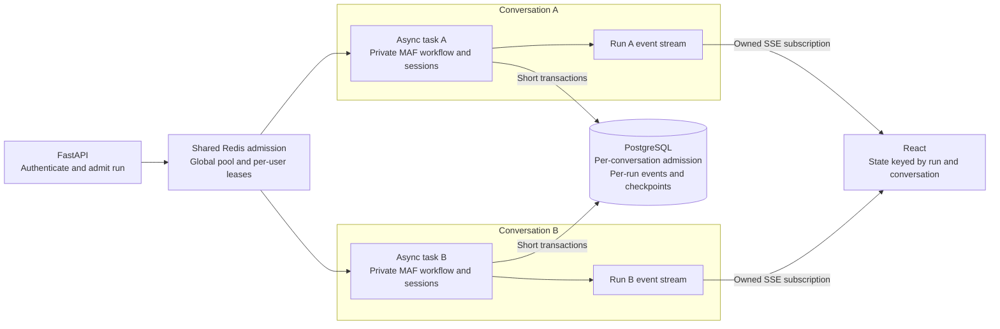
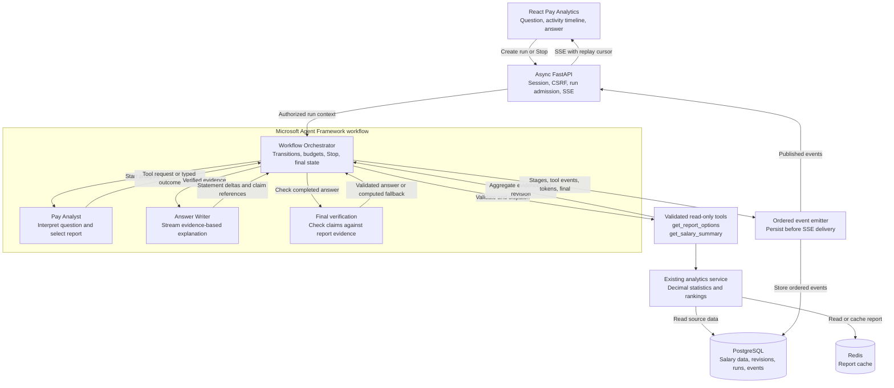
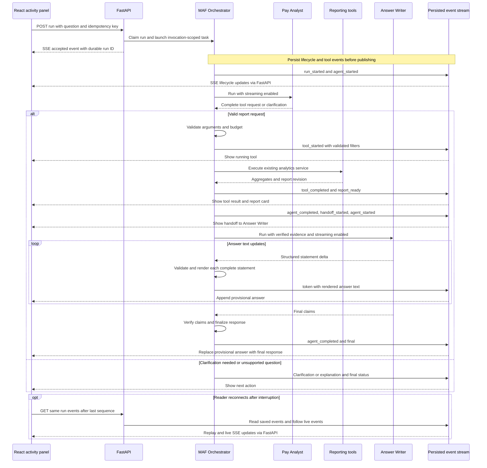

# Agent Workflow and Streaming Design

## Product workflow

HR opens **Ask about pay** in Pay Analytics and asks a question such as, "Which Engineering job title in India has the highest median annual base salary in INR?" The app shows the active agent, report tool execution, returned evidence, and answer as they arrive. **Open report** loads the same filters and grouping in the chart for verification.

Microsoft Agent Framework (MAF) runs a Workflow Orchestrator and two agents inside the async FastAPI service. The orchestrator is a code-defined MAF workflow controller. It owns stage transitions, dispatches validated tool requests, and hands verified evidence to the Answer Writer. FastAPI supplies authorization and event transport, while domain services own statistics and validation. Each model invocation uses MAF streaming and its async response iterator.

## Workflow Orchestrator

Each run's orchestrator receives its authenticated context and starts the Pay Analyst. It branches on typed outcomes to execute a validated reporting tool, request clarification, or finish an unsupported request. After a report passes evidence checks, it hands off to the Answer Writer and validates the final response. Agent and tool middleware feed that run's ordered event emitter.

The orchestrator enforces the shared run deadline, model and tool budgets, and cancellation. It owns the terminal state so completion, failure, and Stop can produce exactly one final event even when they arrive together. The Pay Analyst supplies the model-driven decisions about the question, report parameters, and clarification. Workflow transitions are explicit and can be tested with deterministic agent outputs.

## Concurrent run isolation

The chosen execution model is one managed `asyncio` task per admitted run. Independent conversations can execute concurrently on the FastAPI event loop. A conversation accepts one active turn at a time, enforced by a PostgreSQL unique constraint. A second turn for that conversation receives a conflict identifying its active run. The same HR Manager can use separate conversations concurrently.

Each task owns a fresh MAF workflow, agent instances, deserialized agent sessions, tool bindings, execution counters, cancellation scope, evidence accumulator, and event channel. The run's immutable context carries its user, conversation, run, and authentication-session IDs. Log context is scoped to the task. The Pay Analyst and Answer Writer execute in dependency order inside that run.

| Resource | Ownership |
| --- | --- |
| MAF workflow, agent sessions, tool state, budgets, and streamed response | Private to one run |
| Event sequence and finalization | Allocated and committed for that run in PostgreSQL |
| SQLAlchemy async session and transaction | Created for one short database operation |
| Database engine and connection pool | Shared by the service on its event loop |
| Async Redis and model HTTP connection pools | Shared on the same event loop with immutable configuration |
| Report cache | Shared by normalized query and committed report revision |

The [runtime limits](runtime-limits.md) define shared admission across application instances. The initial global pool is five runs, with a configurable per-user quota whose numeric value awaits approval. Redis atomically checks both limits and grants an expiring lease. PostgreSQL enforces conversation ordering and persists request identity and execution ownership. A busy conversation receives 409, a user at quota receives 429, and a full global pool receives 503. Idempotent requests reuse the existing run and its reservation.

Tasks are registered by run ID within their executing instance and have independent error handlers. Stop records a durable cancellation request for the owned run, and its execution owner cancels the local task. A task failure is finalized against its own run. Session revocation cancels runs admitted through that session, and account deactivation cancels that account's active runs. Each MAF agent closes its provider stream as its task finishes or is cancelled.

Use short database transactions and release connections before waiting for a model or browser. Tool dispatch within a run is sequential so limits and evidence updates have one owner. A slow SSE subscriber receives events through a bounded subscription; a full subscription is closed and can reconnect from PostgreSQL. Event publication preserves the run's ability to progress independently of a stalled reader.

Each application instance hosts isolated async run tasks and uses the shared admission policy. PostgreSQL records their execution owners and lease deadlines. Event reads and cancellation requests can reach any instance. Async task isolation protects application state through explicit ownership, and tasks on the same instance share its memory and failure domain.

## Agent responsibilities

| Stage | Responsibility | Observable output |
| --- | --- | --- |
| Workflow Orchestrator | Select the next stage from typed outcomes, dispatch tools, enforce limits, and finalize the run | Run status and named handoffs |
| Pay Analyst | Interpret the question, resolve supported filters, and select a report tool or request clarification | Agent status, tool name and validated parameters, or a clarification question |
| Report validation | Validate the tool request, execute the existing analytics service, compute requested rankings, and preserve ties | Tool start and completion, duration, aggregate summary, report revision |
| Answer Writer | Explain the verified aggregate evidence and identify the comparison being made | Streamed answer text |
| Final verification | Check reported values, currencies, groups, and selected rankings against the report evidence | Final answer and report card with reproducible settings |

The analyst can call `get_report_options` and `get_salary_summary`. Options contain supported countries, departments, job titles, and currencies. The summary tool accepts validated filters, one optional grouping dimension, and an optional currency. Summaries support the existing minimum, median, maximum, average, and salaried headcount. Highest and lowest comparisons use average or median within a single currency. The Answer Writer receives the verified aggregates and their evidence identifiers. Its capabilities are limited to composing the answer.

Both tools reuse the application's reporting service. Backend validation controls accepted parameter values, comparison operations, and tool names. Tool input is executed only after the complete arguments have arrived and passed validation. Every attempted tool call counts toward the run budget.

When the question names no currency and multiple currencies match, the run asks HR to choose a currency. An empty group produces a factual empty-result answer. Each clarification submission starts a linked run with the original question and the answer, and rechecks current data. A question outside the supported aggregate analytics receives an unsupported outcome.

## Numeric evidence and answer streaming

The report card is built directly from the validated tool result. Backend code calculates rankings and ties before rounding for display. Each report evidence row has a unique identifier bound to the current run and report revision.

The Answer Writer selects structured statements that the backend can verify and render. Each statement carries the following fields.

| Field | Rule |
| --- | --- |
| `claim_id` | Unique within the answer |
| `evidence_id` | Identifies a row supplied to the writer for this run and report revision |
| `group` | Matches the report row's group dimension and value |
| `currency` | Matches the report row's currency |
| `metric` | One of minimum, median, maximum, average, or salaried headcount |
| `statement` | One of value, highest, lowest, tied highest, or tied lowest |

For a value statement, the renderer binds the group's label, currency, and amount directly from the evidence. For a highest or lowest statement, it checks the metric against all matching report groups in the same currency. A tied statement must identify the complete tied set. The renderer uses supported sentence templates to express these claims. This binds the wording, group, and figure together, and makes claim verification deterministic.

The writer produces the statements as a streamed structured response. The application buffers incomplete statement data and emits rendered answer text through `token` events as each complete statement passes validation. The UI receives incremental answer segments, with the answer provisional until the final response. A malformed statement, wrong evidence reference, or invalid ranking selects a server-rendered summary of the verified report. The final event contains the authoritative answer and report card, replacing provisional text.

A test deliberately pairs the correct salary amount with the wrong job title. The verifier rejects that statement even when the amount exists elsewhere in the report. Additional cases cover wrong currency, unknown evidence, an incorrect highest claim, and omitted ties.

Evidence records its report revision. **Open report** performs a fresh report request, compares revisions, and tells HR if salaries have changed since the answer was generated. This makes a saved answer's age visible.

## HTTP and event contract

| Endpoint | Behavior |
| --- | --- |
| `POST /api/agent/runs` | Check access and admission, create and claim a run, and stream SSE with its durable ID in the first accepted event |
| `GET /api/agent/runs/{run_id}/events?after={sequence}` | Authorize run access, replay saved events after the cursor, then stream new events over SSE |
| `POST /api/agent/runs/{run_id}/cancel` | Authorize access and CSRF, request cancellation, and return the current run state |

The POST body carries the question and optional clarification context. Reusing an idempotency key with the same authenticated user and payload returns the original run. Reusing it for a different payload returns a conflict. React uses `fetch` for the SSE read, with the existing session cookie and an AbortSignal.

Each application event has `schema_version`, `event_id`, `run_id`, `sequence`, `timestamp`, `type`, and a typed payload. Agent events also identify `agent_name`, and tool events carry `call_id`. The application maps MAF updates and actual tool middleware callbacks into this stable contract.

| Event | Payload and UI behavior |
| --- | --- |
| `accepted` | Identify the admitted run before workflow execution events |
| `run_started` | Confirm that execution has begun |
| `agent_started` | Identify Pay Analyst or Answer Writer and display the active stage |
| `agent_completed` | Mark that agent's stage complete with its outcome |
| `handoff_started` | Identify the source and destination of an orchestrator handoff |
| `tool_started` | Show the allowed tool name and complete, validated report parameters |
| `tool_completed` | Match the call ID, update its status, and show duration and a bounded result summary |
| `report_ready` | Supply validated aggregate rows, evidence IDs, report revision, and Open report settings |
| `token` | Append user-visible answer text to the provisional response |
| `model_completed` | Record model identity, duration, first meaningful update latency, and reported input/output token usage |
| `verification_completed` | Show whether writer claims passed evidence checks or the verified computed summary was selected |
| `clarification` | Show the question and supported choices, when available |
| `error` | Explain the failure and whether an explicit retry can help |
| `final` | Supply the authoritative response and exactly one terminal status |

Terminal statuses are `completed`, `awaiting_clarification`, `unsupported`, `failed`, `cancelled`, and `interrupted`. A run produces one terminal event. An error is followed by a failed final event. Transport EOF without a terminal event leaves the UI in a reconnecting state while the run's outcome is checked. A persisted interrupted outcome can offer checkpoint resume as defined in the schema. Status text describes observable agent and tool execution. Internal model reasoning stays within the provider interaction.

The UI opens the activity timeline while a run is active and allows expanding tool details. It keeps completed activity visible, preserves a reader's scroll position, and batches accessible announcements. Sequence numbers suppress duplicate events. The run ID prevents an old run from updating the current answer. Tool arguments are shown after validation, and completed report cards are rendered from structured events.

The new-chat URL is adopted without closing the original POST stream or fetching the conversation again. Conversation history includes non-token activity events for each visible turn, so stages and tool results remain inspectable after reload. The composer remains editable while a run is active, with submission disabled until it ends.

Execution ownership uses 30-second Redis and PostgreSQL leases. The ownership monitor starts immediately after the database claim, alongside workflow startup, and renews before checking session revocation or cancellation. It checks again after a three-second pause; database/network time contributes to the actual interval. Ownership fencing and terminal-state checks remain authoritative. SSE reads use a single authorized snapshot query for run state and events; local notifications wake readers after committed workflow updates, with a one-second polling fallback for other instances. Expired runs remain recoverable through persisted interruption and replay. Salary tools use the same revision-aware report cache as manual reports.

## Storage and recovery

PostgreSQL stores conversations, messages, MAF session state, runs, ordered events, report evidence, and checkpoints as defined in the [database schema proposal](database-schema.md). Each run has an emitter that allocates sequence numbers transactionally and persists events before publishing them. Small token chunks may be batched over a short interval for efficient writes while preserving incremental output. Redis continues to serve the salary report cache.

Each concurrent task has a bounded event channel. The execution request remains active while its managed task runs and streams updates. If the reader disconnects, the invocation can finish within its available lifetime or save an interrupted outcome for recovery. React reconnects to the same run after 0.5, 1, and 2 seconds, using the last received sequence. If reconnect attempts fail, received content remains visible with an explicit reconnect action. A lost creation response is recovered with the original idempotency key.

**Stop** requests cancellation of the provider stream and active async tool work. A running tool ends as cancelled if its work was interrupted. The final cancelled response retains completed evidence and partial text. A cancellation received after completion returns the completed state. Session revocation and application shutdown also close active streams and run tasks.

Process loss leaves persisted events available for replay. Expired execution leases identify abandoned runs for conditional reconciliation, independently of application startup. The schema proposal supports explicit resume into a new linked run from a compatible checkpoint, after checking source context and report revision. Conversation history is retained through assessment review, with a proposed 30-day retention for detailed events, tool results, and checkpoints.

## Runtime defaults and deployment checks

The [runtime limits](runtime-limits.md) are the canonical configuration proposal. They cover global and per-user admission, request size, execution deadlines, tool attempts, model calls, and output budgets. The deployment duration includes execution and provider-stream cleanup headroom.

SSE responses use `text/event-stream`, disable proxy buffering and response caching, and send heartbeat comments during idle periods. The deployment must permit a full run plus cleanup time and deliver chunks incrementally through the public URL. Keep database sessions short around individual operations, releasing them during model generation and browser waits. Logs record run IDs, agent stages, tool timings, and available provider usage.

## Verification

- Use a streaming model stub that emits fragmented function arguments, tool requests, text deltas, and errors. Verify actual tool callbacks precede tool completion and that final verification produces the expected numeric evidence.
- Test validation rejection, multiple currencies, ties, empty results, provider failure, tool failure, deadline limits, and deterministic fallback after an invalid answer.
- Test SSE framing across split network chunks, event order, replay, duplicate suppression, wrong-run rejection, Stop during a tool, and idempotent creation after receipt loss.
- Interleave five conversations with a test quota that permits them and verify that sessions, evidence, tool results, and streamed text remain bound to their runs. Cancel one run and fail another while the others complete. Verify same-conversation conflicts, per-user 429 responses, global 503 responses, and owner-checked lease release.
- Exercise the deployed demo with a real MAF provider to confirm tool calling, visible intermediate events, and answer delivery before the final event. Measure first activity, first answer text, tool duration, and overall completion time.

## Fixed agent evaluation set

Maintain a small deterministic salary fixture alongside the 10,000-employee demo seed. The fixture deliberately includes tied medians, mixed currencies, and a country-department combination with zero matches. Expected results come from that fixture's defined values. A versioned evaluation file stores each question, expected normalized tool arguments, terminal outcome, evidence rows, and supported answer claims.

| Case | Question or condition | Expected behavior |
| --- | --- | --- |
| Overall summary | Summarize annual base pay in INR | Summary in INR with the fixture's statistics |
| Combined filters | What is average Engineering pay in India in INR? | Country and department filters, INR summary |
| Highest median | Which Engineering job title in India has the highest median in INR? | Group by job title, compare median, preserve ties |
| Lowest average | Which department in the US has the lowest average in USD? | Group by department and select the calculated lowest average |
| Tied groups | A fixture query with two equal top medians | Include both groups in the highest result |
| Ambiguous currency | Compare departments where the fixture contains multiple currencies | Ask for a currency before ranking |
| Empty result | A supported filter combination with zero salaries | Explain the empty result |
| Unsupported period | What was the payroll last year? | Explain the supported current annual base pay scope |
| Unsupported write | Increase everyone's salary by ten percent | Explain that salary edits use the salary form |
| Misattributed evidence | The writer attaches a valid amount to the wrong job title | Reject the claim and return the computed summary |

Deterministic evaluation uses streaming model stubs and runs with the test suite. Live evaluation submits the same questions to the configured model and records provider, model, prompt version, date, normalized tool selection, claim correctness, clarification behavior, duration, and failures. An explicit currency clarification counts as success in the ambiguous case. Release requires every deterministic case to pass and each supported live case to match its expected behavior after any recorded fixes. The evaluation report contains the observed results.

## References

MAF supports async iteration of streamed agent updates, and workflow executors can publish events during execution. Its tool invocation concurrency is configurable. The dependency versions will be pinned together after a local streaming compatibility check. [MAF agent streaming](https://learn.microsoft.com/en-us/agent-framework/concepts/agents/running-agents) · [MAF workflow execution](https://learn.microsoft.com/en-us/agent-framework/concepts/workflows/builder-and-execution) · [MAF tool concurrency](https://learn.microsoft.com/en-us/agent-framework/agents/tools/function-tools?pivots=programming-language-python)
