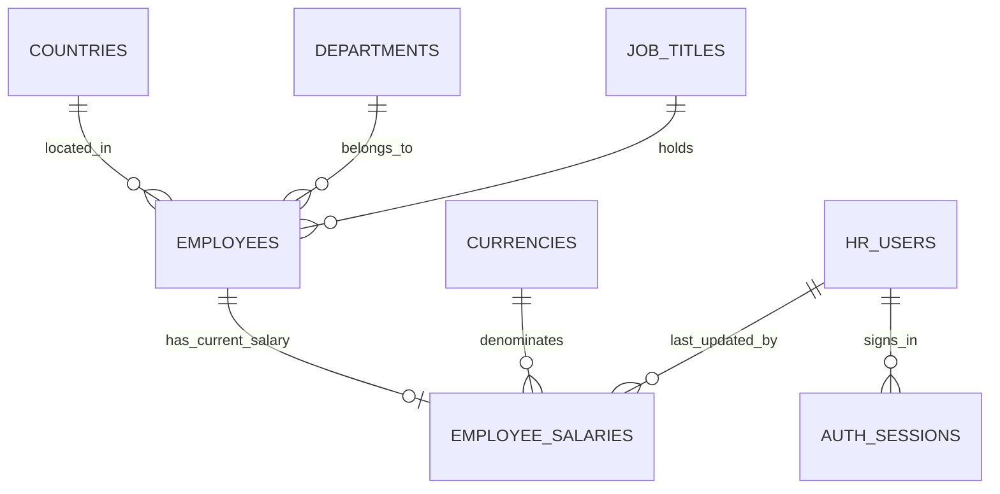
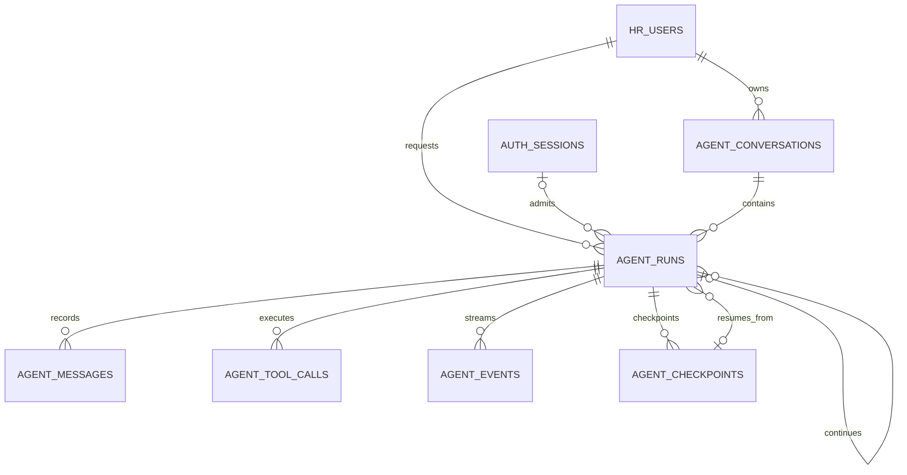

# Salary Management PostgreSQL Schema

## Review status

This is the proposed database design for approval before migrations or application code. PostgreSQL stores the employee records, authentication sessions, agent conversations, tool results, stream events, and MAF checkpoints. Redis remains the analytics cache in the system design.

The database uses one application namespace, `app`. Table and column names below are proposed physical names. Identifiers use UUIDs for accounts and agent resources and generated BIGINT keys for employee records and lookup tables. Timestamps use `TIMESTAMPTZ` and are stored in UTC. Unless marked optional, columns are required.

## Tables at a glance

| Area | Tables | Purpose |
| --- | --- | --- |
| Access | `hr_users`, `auth_sessions` | HR identity and revocable sign-in sessions |
| Reference data | `countries`, `currencies`, `departments`, `job_titles` | Consistent filters and supported salary currencies |
| Salary management | `employees`, `employee_salaries`, `report_state` | Directory, one current salary per employee, and report cache revision |
| Agent conversations | `agent_conversations`, `agent_runs`, `agent_messages` | Saved chats, individual workflow executions, and visible messages |
| Agent execution | `agent_tool_calls`, `agent_events`, `agent_checkpoints` | Durable tool evidence, stream replay, and workflow recovery |

## Employee and access relationships

### hr_users

| Column | Type | Rules |
| --- | --- | --- |
| `id` | UUID | Primary key |
| `email` | TEXT | Stored normalized to lowercase, unique |
| `display_name` | TEXT | HR account label |
| `password_hash` | TEXT | Encoded password hash |
| `is_active` | BOOLEAN | Default true |
| `created_at` | TIMESTAMPTZ | Creation time |

The demo seeds one HR Manager. A dedicated role table can be added when the product has more than one permission level.

### auth_sessions

| Column | Type | Rules |
| --- | --- | --- |
| `id` | UUID | Primary key |
| `user_id` | UUID | Foreign key to `hr_users.id` |
| `token_hash` | BYTEA | Unique hash of the random session token |
| `csrf_token_hash` | BYTEA | Hash used to verify the request's CSRF token |
| `created_at` | TIMESTAMPTZ | Creation time |
| `expires_at` | TIMESTAMPTZ | Later than creation time |
| `revoked_at` | TIMESTAMPTZ | Optional, populated on sign-out or revocation |

The browser holds the random session token in a secure HTTP-only cookie. Authentication checks session expiration, revocation, and the account's active flag. The database holds token hashes. Clearing a login session preserves the user's conversation history.

### Reference tables

| Table | Columns | Keys and rules |
| --- | --- | --- |
| `countries` | `code TEXT`, `name TEXT` | Two-letter uppercase code is the primary key |
| `currencies` | `code TEXT`, `name TEXT`, `minor_units SMALLINT` | Three-letter uppercase code is the primary key; checks restrict this release to INR, USD, GBP, EUR with minor units 2 |
| `departments` | `id BIGINT`, `name TEXT` | Generated primary key; normalized name unique |
| `job_titles` | `id BIGINT`, `name TEXT` | Generated primary key; normalized name unique |

The reference tables provide the form and report options. Employee country and salary currency are recorded independently. A job title can occur in several departments. Reference names are normalized before insertion so capitalization and surrounding whitespace do not create duplicate options.

### employees

| Column | Type | Rules |
| --- | --- | --- |
| `id` | BIGINT | Generated primary key |
| `employee_code` | TEXT | Required, unique HR-facing employee ID, such as EMP-000001 |
| `full_name` | TEXT | Display and search name |
| `country_code` | TEXT | Foreign key to `countries.code` |
| `department_id` | BIGINT | Foreign key to `departments.id` |
| `job_title_id` | BIGINT | Foreign key to `job_titles.id` |
| `created_at` | TIMESTAMPTZ | Creation time |

The UI labels `employee_code` as **Employee ID** and supports searching by it. The internal `id` supplies the stable key used by salary foreign keys and API resources.

On a fresh database, the seed creates exactly 10,000 employees with employee IDs EMP-000001 through EMP-010000 and one salary for each. Repeating the seed reuses the same employee IDs and preserves the employee count at 10,000. An employee may have zero current salary records so HR can enter a salary later. The directory shows that as a missing salary, and statistics exclude it.

### employee_salaries

| Column | Type | Rules |
| --- | --- | --- |
| `employee_id` | BIGINT | Primary key and foreign key to `employees.id` |
| `annual_gross_base` | NUMERIC(11,2) | Check from 0.01 through 999999999.99 |
| `currency_code` | TEXT | Foreign key to `currencies.code` |
| `updated_by` | UUID | Foreign key to `hr_users.id` |
| `updated_at` | TIMESTAMPTZ | Last committed salary update |

The primary key enforces one current salary per employee. Amount and currency are saved together. API validation rejects an amount that cannot be represented exactly to two decimal places before PostgreSQL receives it. Calculations use decimal arithmetic and round half-up at the presentation boundary. The proposed currencies and range remain product choices for review.

### report_state

| Column | Type | Rules |
| --- | --- | --- |
| `id` | SMALLINT | Primary key, check equals 1 |
| `revision` | BIGINT | Non-negative report revision |
| `updated_at` | TIMESTAMPTZ | Most recent revision change |

A migration creates the singleton row. Every write that affects reporting, including seed refreshes, increments its revision in the same transaction. Salary aggregates and their revision are read from a consistent database snapshot.

## Conversation and execution relationships

### agent_conversations

| Column | Type | Rules |
| --- | --- | --- |
| `id` | UUID | Primary key |
| `user_id` | UUID | Foreign key to `hr_users.id` |
| `title` | TEXT | Human-readable chat title |
| `deleted_at` | TIMESTAMPTZ | Nullable; soft-deleted chats are hidden from history, admission, and owned run reads; cleared by Undo |
| `next_turn_number` | BIGINT | Positive counter, default 1 |
| `context_version` | BIGINT | Non-negative version of committed conversation state |
| `agent_session_state` | JSONB | Complete serialized MAF sessions, keyed by logical agent identity |
| `created_at` | TIMESTAMPTZ | Creation time |
| `updated_at` | TIMESTAMPTZ | Latest committed conversation change |

The session payload includes the framework message and provider state needed to reopen the conversation. Application message rows provide the visible chat history. The serializer version and runtime fingerprint are stored in the session envelope. The next model request loads a bounded history of committed exchanges, including complete tool-call and result pairs. Partial interrupted replies remain visible in chat, with their in-progress framework state held in checkpoints.

### agent_runs

| Column | Type | Rules |
| --- | --- | --- |
| `id` | UUID | Primary key |
| `conversation_id` | UUID | Foreign key to `agent_conversations.id` |
| `user_id` | UUID | Owner, enforced against the conversation owner |
| `auth_session_id` | UUID | Optional foreign key to the admitting `auth_sessions.id` |
| `turn_number` | BIGINT | Positive, unique within the conversation |
| `kind` | TEXT | `question`, `clarification`, `retry`, or `resume` |
| `parent_run_id` | UUID | Optional source run for a follow-up operation |
| `resume_checkpoint_id` | UUID | Optional source checkpoint for a resumed run |
| `idempotency_key` | UUID | Unique together with `user_id` |
| `request_hash` | BYTEA | Hash of the normalized submitted request, including conversation and source identifiers |
| `status` | TEXT | Checked run state listed below |
| `base_context_version` | BIGINT | Conversation version when the run was admitted |
| `last_event_sequence` | BIGINT | Starts at zero and increases on event persistence |
| `runtime_fingerprint` | TEXT | Identifies workflow, MAF, prompts, tool schema, model settings, and serializer versions |
| `runtime_limits` | JSONB | Limits pinned to this run |
| `execution_owner_token` | UUID | Optional token identifying the invocation that owns execution |
| `execution_lease_expires_at` | TIMESTAMPTZ | Optional execution ownership deadline |
| `cancel_requested_at` | TIMESTAMPTZ | Optional cancellation request time |
| `created_at` | TIMESTAMPTZ | Admission time |
| `started_at` | TIMESTAMPTZ | Optional execution start |
| `finished_at` | TIMESTAMPTZ | Optional terminal time |

States are `queued`, `running`, `completed`, `awaiting_clarification`, `unsupported`, `failed`, `cancelled`, and `interrupted`. The last six are terminal for that run ID. A resume creates a new run linked to the interrupted source and checkpoint. The original run keeps its own outcome and event history.

Use a composite foreign key from `(conversation_id, user_id)` to a matching unique key on conversations. A composite session reference ensures the admitting session belongs to the same user. Parent runs must belong to the same conversation. The resume source references `(checkpoint_id, parent_run_id, conversation_id)` to ensure the checkpoint belongs to that exact source run. A partial unique index on `conversation_id` for `queued` and `running` enforces one active turn per conversation. Separate conversations owned by the same HR Manager can execute concurrently.

The request hash uses the submitted payload, including explicit source references. Idempotent replay looks up the saved request before checking live conversation state, so a repeated creation request still returns its original run after the conversation has advanced.

### agent_messages

| Column | Type | Rules |
| --- | --- | --- |
| `id` | UUID | Primary key |
| `run_id` | UUID | Foreign key to `agent_runs.id` |
| `role` | TEXT | `user` or `assistant`, unique together with `run_id` |
| `text` | TEXT | Question, final answer, or retained partial reply |
| `structured_content` | JSONB | Report card, verified claim references, report settings, or clarification choices |
| `is_partial` | BOOLEAN | Marks an interrupted or cancelled partial reply |
| `created_at` | TIMESTAMPTZ | First persistence time |
| `updated_at` | TIMESTAMPTZ | Latest persistence time |

The user message is inserted when the run is admitted. The assistant message is saved as the run reaches an outcome, including partial output on cancellation or interruption. Chat ordering uses `agent_runs.turn_number`, then user followed by assistant. The run relationship supplies the conversation and owner, avoiding duplicate ownership columns in messages.

### agent_tool_calls

| Column | Type | Rules |
| --- | --- | --- |
| `id` | UUID | Primary key, used as the outward event `call_id` |
| `run_id` | UUID | Foreign key to `agent_runs.id` |
| `attempt_number` | SMALLINT | Positive, unique within the run |
| `agent_name` | TEXT | Logical agent requesting the call |
| `tool_name` | TEXT | `get_report_options` or `get_salary_summary` |
| `arguments` | JSONB | Complete validated tool input |
| `status` | TEXT | `running`, `completed`, `failed`, or `cancelled` |
| `result` | JSONB | Optional bounded options or aggregate evidence with evidence IDs |
| `report_revision` | BIGINT | Optional, populated for a salary summary |
| `error_code` | TEXT | Optional stable failure code |
| `started_at` | TIMESTAMPTZ | Tool invocation time |
| `finished_at` | TIMESTAMPTZ | Optional tool completion time |

This table makes tool results inspectable and supplies the report evidence saved into a checkpoint. Rejected tool requests still consume the run's attempt budget and are recorded as validation error events. Completed tool evidence is immutable. A cancelled run can retain a report from a tool that completed before cancellation.

### agent_events

| Column | Type | Rules |
| --- | --- | --- |
| `run_id` | UUID | Foreign key to `agent_runs.id`, part of the primary key |
| `sequence` | BIGINT | Positive, part of the primary key |
| `event_id` | UUID | Unique outward event identifier |
| `schema_version` | SMALLINT | Positive event format version |
| `event_type` | TEXT | Event type from the streaming contract |
| `agent_name` | TEXT | Optional agent identity |
| `call_id` | UUID | Optional tool reference |
| `payload` | JSONB | Typed event content |
| `created_at` | TIMESTAMPTZ | Persistence time |

The ordered key supports replay using `sequence > cursor`. A composite foreign key binds `(run_id, call_id)` to the matching tool call, when present. A partial unique index on `run_id` where `event_type = 'final'` enforces one terminal event. The persisted event is published to SSE after commit.

### agent_checkpoints

| Column | Type | Rules |
| --- | --- | --- |
| `id` | UUID | Primary key |
| `run_id` | UUID | Foreign key to `agent_runs.id` |
| `conversation_id` | UUID | Enforced against the source run's conversation |
| `checkpoint_number` | BIGINT | Positive, unique within the run |
| `sdk_checkpoint_id` | TEXT | Native MAF checkpoint identity, unique within the source run |
| `workflow_name` | TEXT | Stable workflow identity |
| `runtime_fingerprint` | TEXT | Compatibility identity matching the creating workflow |
| `serializer_version` | SMALLINT | Payload codec version |
| `last_event_sequence` | BIGINT | Committed event cursor associated with this checkpoint |
| `source_report_revision` | BIGINT | Optional revision of report evidence in the checkpoint |
| `payload` | JSONB | Full serialized workflow snapshot |
| `created_at` | TIMESTAMPTZ | Save time |

The payload contains executor states, pending messages, serialized agent sessions, accumulated evidence, remaining budgets, and completed tool references. A custom MAF checkpoint storage adapter writes these rows. Workflow state uses JSON-compatible values and a versioned codec. Checkpoints are saved at framework-supported stage boundaries, including entry, after report evidence is ready, and after answer completion when the workflow reaches those boundaries.

## Transactions and recovery rules

1. **Admit a turn.** Return an existing idempotent run when available, then reserve shared global and per-user capacity outside the database transaction. Lock the conversation, verify its owner, recheck the idempotency key and source context, allocate the next turn number, and insert the run plus user message atomically. A repeated key with a different request hash returns a conflict. The unique active-run index serializes admissions for one conversation. A conditional execution claim records the owner token and lease deadline. Admission failure releases its reservation using that owner identity.
2. **Save salary.** Write amount and currency and increment `report_state.revision` atomically. Queries read a committed report snapshot. The cache key includes the report revision.
3. **Append events.** Lock the run, check current execution ownership, allocate increasing sequences, insert events, and update `last_event_sequence` in a short transaction. Publish after commit. Publishers for the same run share that allocator, while distinct runs lock separate rows. Checkpoint and finalization writes also verify ownership.
4. **Save a boundary.** Persist the completed tool state and related events before recording a checkpoint that references them. The checkpoint cursor identifies a committed prefix of the stream. The storage adapter verifies the referenced evidence is durable before completing the checkpoint save.
5. **Finalize.** Lock the run and atomically save its status, assistant message, and final event. For completed answers and completed clarification requests, update the conversation's committed session state and increment `context_version`. Failed, interrupted, and cancelled execution retains the preceding committed conversation state. A second finalization attempt returns the persisted outcome. Cancellation and completion use the same finalization path.
6. **Replay a stream.** Read saved events for the owned run after the client's cursor, then follow live events. The reader can reconnect independently of workflow execution.
7. **Reopen a chat.** Load owned conversation messages and deserialize its committed MAF session state for the next turn. Reopening checks the current report revision before answering a new pay question.
8. **Resume a workflow.** Resume is offered for the latest interrupted run with a compatible checkpoint and unchanged conversation context. Lock the conversation, recheck ownership and source state, create a new linked run, and restore MAF from that checkpoint. Event sequences begin at 1 for the new run, whose initial event identifies its source run and checkpoint. Restored evidence keeps its source tool-call identity; the verifier authorizes that evidence through the recorded checkpoint lineage and the revision check.
9. **Validate resumed evidence.** Compare the checkpoint's source report revision with the current revision. A changed report asks HR to run a fresh analysis. The resume preserves the original remaining tool and output budgets. A new execution attempt receives a fresh wall-clock deadline and is recorded as a new run.
10. **Recover process loss.** Reconciliation conditionally marks queued or running runs with expired execution leases as interrupted, saves their partial reply and terminal event, and closes unfinished tool records. It verifies that the execution owner has expired before changing the row. Compatible saved checkpoints become available for an explicit Resume. Execution continues from a saved boundary, and a provider call interrupted between boundaries may be repeated.

Explicit Stop ends a run as cancelled. A follow-up request or retry starts a linked run. A clarification starts a linked turn with the original question and the user's answer. These operations preserve the earlier records and their outcomes.

## Initial indexes

Primary and unique keys create their normal indexes. Add the following access-path indexes with the initial schema and confirm directory performance against the seed.

| Table | Index | Supports |
| --- | --- | --- |
| `employees` | `(country_code, department_id, job_title_id, id)` | Combined country-first filtering and stable pagination |
| `employees` | `(department_id, id)` and `(job_title_id, id)` | Independent dimension filters |
| `auth_sessions` | Unique `(id, user_id)` | Same-user run admission reference |
| `agent_conversations` | `(user_id, updated_at DESC, id)` | Owned chat list |
| `agent_conversations` | Unique `(id, user_id)` | Same-owner conversation reference |
| `agent_runs` | Unique `(conversation_id, turn_number)` | Conversation ordering |
| `agent_runs` | Unique `(user_id, idempotency_key)` | Retry-safe creation |
| `agent_runs` | Unique `(conversation_id)` for active states | One active turn per conversation |
| `agent_runs` | Unique `(id, conversation_id)` | Same-conversation parent and checkpoint constraints |
| `agent_checkpoints` | `(run_id, checkpoint_number DESC)` | Latest saved boundary |
| `agent_checkpoints` | Unique `(id, run_id, conversation_id)` | Checkpoint belongs to the exact resume source run |
| `agent_events` | Primary key `(run_id, sequence)` | Ordered SSE replay |
| `agent_events` | Unique `(run_id)` for final events | One terminal event |
| `agent_tool_calls` | Unique `(id, run_id)` | Same-run event references |

Employee name search initially uses a case-insensitive substring query over 10,000 rows. The load check determines whether a specialized search index is warranted. Report correctness uses PostgreSQL source data and the shared revision regardless of the indexes chosen.

## Constraints and retention

Deleting reference data that employees or salaries use is restricted. Conversations, runs, messages, events, tool calls, and checkpoints are ownership-scoped. Composite foreign keys bind cross-record references to the same conversation or run. Check constraints enforce valid states, positive counters, and timestamp ordering. Terminal runs have a finish time, and active runs have none.

A `resume` run requires a parent and checkpoint. A `clarification` or `retry` run requires a parent. The database rejects self-parent references, and application validation accepts source references only to an existing earlier turn in the same conversation.

The proposed retention policy keeps conversations, messages, and final report cards through assessment review. Detailed events, tool evidence, and checkpoints remain for 30 days after a run finishes, and active runs are excluded from cleanup. After that window, messages remain readable and the UI marks execution replay and checkpoint resume as expired. Cleanup clears expired checkpoint references and deletes dependent execution details in a transaction.

JSONB holds variable framework state, typed events, and report payloads inside PostgreSQL. Relational columns and foreign keys own identity, access, ordering, state, and source relationships. The seed refresh preserves user conversations and advances the existing report revision monotonically so saved evidence can be identified as older data.

## Implementation acceptance checks

- Verify primary and foreign keys, state and amount checks, one-current-salary enforcement, same-owner source references, and one active run per conversation.
- Verify that the fresh seed has 10,000 employees, 10,000 distinct employee IDs, and 10,000 linked salary records, and that a second seed run preserves these counts and employee identities.
- Exercise two concurrent salary saves and confirm both the final amount and monotonic report revision.
- Exercise duplicate run admission, out-of-order event producers, concurrent Stop and completion, and a failure between tool completion and checkpoint persistence.
- Admit five independent conversations under a test quota that permits them and verify separate turn numbers, event sequences, checkpoints, and session-state updates. Two admissions for the same conversation produce one active run and a conflict for the second request. Admission across separate instances respects the shared user and global limits, and expired owners cannot write new events or finalize a run.
- Round-trip a real MAF session and checkpoint through the proposed PostgreSQL codec, rebuild the same workflow, and resume from the saved boundary with streaming enabled.
- Verify that changed salaries, a later conversation turn, an incompatible runtime fingerprint, and an expired checkpoint each prevent stale restoration.
- Restart the application after a saved report checkpoint, resume explicitly, and verify the answer retains its group, currency, tool evidence, and source revision.

The schema is a design proposal. Migration execution and MAF round-trip verification follow approval.

## Framework references

MAF persists conversation sessions and workflow checkpoints for different purposes. This design uses PostgreSQL for both through application storage adapters. Checkpoint recovery depends on a compatible workflow and serialized state. [MAF conversation storage](https://learn.microsoft.com/en-us/agent-framework/concepts/agents/conversations/storage) · [MAF workflow checkpoints](https://learn.microsoft.com/en-us/agent-framework/workflows/checkpoints)

### saved_reports

Migration 0006 adds owner-scoped independent snapshots with UUID identity, source run/conversation identifiers, title, description, JSONB report and chart preferences, immutable answer summary, snapshot version, generation/saved timestamps and nullable deletion timestamp. `(user_id, source_run_id)` is unique. Only the owner reference is a foreign key; source deletion must not cascade into this library. Source availability is computed for navigation only, never needed to render copied evidence.
