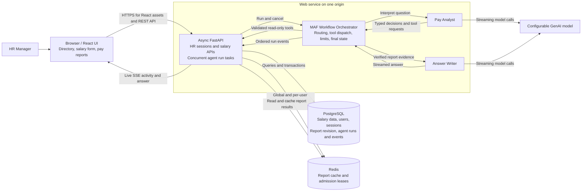
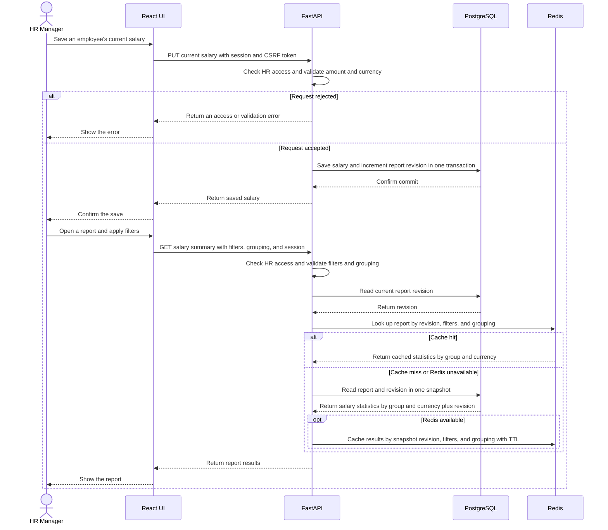
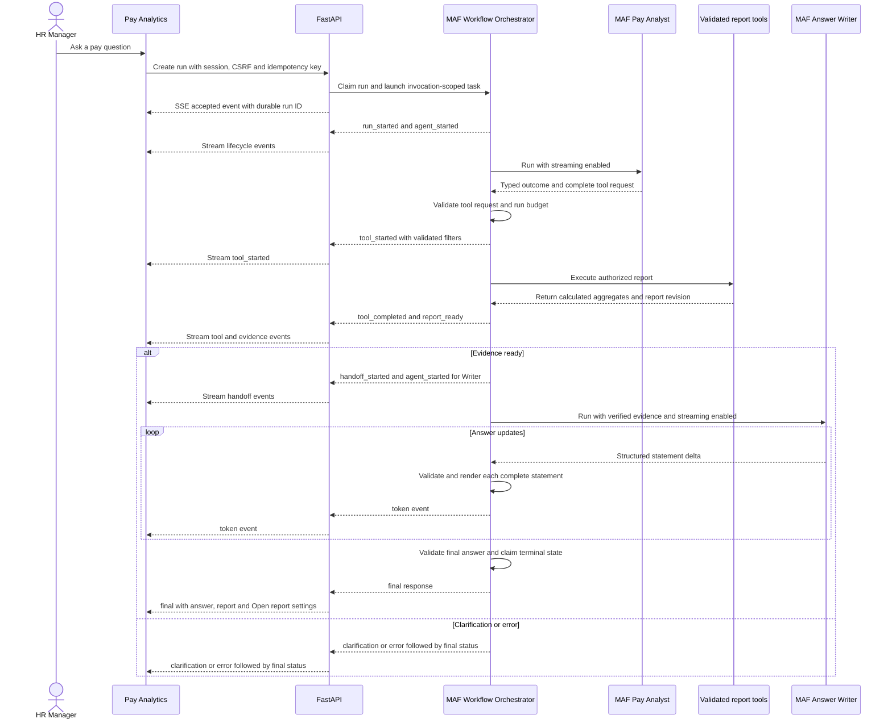

# Salary Management System Design

One HR manager can find an employee, enter or update their current annual gross base salary, and see how pay varies by country, department, and job title. The deployed demo uses 10,000 synthetic employee records. Monthly pay, bonuses, salary history, payroll, exchange-rate conversion, and multiple roles are outside the proposed scope.

## Deployment and access

Deploy one FastAPI web service that serves the React build, API, and SSE streams from the same origin. MAF runs in that service, with async PostgreSQL and Redis clients. FastAPI handles the single HR Manager login and stores server-side sessions in PostgreSQL. Employee, salary, analytics, and agent run endpoints check authentication and ownership. Writes and run creation or cancellation require CSRF validation. The application uses synthetic data and keeps deployment secrets outside Git.

Each agent run has a private async task, MAF workflow, and session state. One active turn per conversation protects chat ordering. Shared Redis leases enforce the global pool and per-user quota across instances. PostgreSQL stores execution ownership, and the initiating request stays active while the run streams. The [runtime limits](runtime-limits.md) define admission responses and the proposed budgets.

Redis is a required deployment component and is reachable only by the backend. FastAPI checks the HR session before looking up any cached report. PostgreSQL stores the source data and serves reports directly during a Redis outage.

## Salary data and reports

- Store employee ID, name, country, department, and job title. Keep one current salary per employee, with an exact decimal amount and a currency code. Validate the amount and currency before saving, and enforce the one-current-salary rule in the database.
- The directory applies search, filters, a stable sort, and pagination on the server. The report can combine country, department, and job title filters and optionally group by one of those dimensions. Salary statistics use everyone with a recorded salary in the matching population.
- For each group and currency, return average, median, minimum, maximum, and the number of salaries included. For an even-sized group, median is the mean of the two middle salaries. Keep calculations in decimal and round for display. An empty result is shown as an empty state.

## Proposed salary policy

The initial demo supports INR, USD, GBP, and EUR, all using two fractional digits. The supported set is returned by the backend for the form and report controls. Annual salary is positive, with a proposed range of 0.01 through 999,999,999.99 in each recorded currency. These are product choices for review before implementation.

- Store salary in PostgreSQL as `NUMERIC(11,2)`. Application validation and database constraints enforce the supported currency, positive amount, and range. Validate fractional precision before storage so an invalid amount receives a field error instead of being silently rounded by the database.
- The API accepts finite decimal strings. Reject zero, negative values, amounts outside the range, and amounts that cannot be represented exactly at two decimal places. Updating amount and currency is atomic, and the entered amount is interpreted in the selected currency.
- Use decimal calculations for reports, including the mean of the middle two values for an even median. Calculate averages and rankings before display rounding. Format monetary API values to two decimal places using half-up rounding. Database and application calculations preserve decimal arithmetic through aggregation.
- Tests cover both range boundaries, values just outside them, zero, negatives, excessive fractional precision, unsupported currencies, and half-up rounding. A report test includes two distinct averages that look equal after rounding to verify that ranking uses the calculated values.

## Shared API expectations

- The backend supplies valid country, department, job title, and salary currency options. Both screens use the same filter values. Directory responses include the rows, page, page size, and total number of matching employees.
- Salary amounts and monetary statistics cross the API as decimal strings. Each report row identifies its group and currency. Without grouping, the API returns one summary per currency. Selecting a display currency in React uses the rows already returned by the report.
- An empty query result is a successful response with an empty list. Expired or missing sessions produce a distinct response from invalid filters or form fields so the UI can send HR to sign-in or preserve the inputs and show a correction.

## Redis report cache

- Cache the complete set of salary statistics for a particular filter combination and grouping dimension. Use a key built from the normalized country, department, and job title filters, the grouping dimension, and the current report revision from PostgreSQL. Directory results and individual salaries use PostgreSQL directly.
- Increment the report revision in the same transaction as any change to the data used in reports, including salary saves and seed refreshes. A report requested after the commit uses the new revision. One shared revision invalidates every filter combination at once, which keeps the design simple for occasional HR edits. On a cache miss, read the report and its revision in one database snapshot so a concurrent edit cannot associate old statistics with a newer revision.
- Use a proposed 60-second TTL to clear old entries and short Redis timeouts. If Redis is unavailable, return the PostgreSQL result. If only the cache write fails, the computed report is still returned.

## Salary update and report flow

Each save is atomic. If the same salary is edited in two sessions, the last successful save wins. A database write failure rolls back both the salary change and revision increment. The form keeps the entered values available for a retry.

## Ask about pay

A code-defined MAF Workflow Orchestrator coordinates a Pay Analyst, validated report tools, evidence checks, and an Answer Writer. It owns routing between stages, handoffs, budgets, cancellation, and the terminal result. FastAPI supplies authentication, reporting services, event persistence, and SSE transport. The [streaming workflow design](agent-streaming-design.md) defines these responsibilities and the event contract.

The tools call the same reporting service as the manual chart, with the same Redis cache and PostgreSQL fallback. Validated numeric evidence drives the report card and final answer checks. A saved answer identifies its report revision. Opening the report fetches current figures and shows when a later salary edit has changed the revision.

## Load and verification

- **Load assumption.** Start with one HR operator. Exercise directory search and reports with one and five concurrent authenticated sessions against the 10,000-employee seed. Record the environment, concurrency, request count, median and p95 latency, and error rate. These are proposed checks. The assessment specifies the dataset size and leaves concurrency open.
- **Data access.** Use server-side pagination and inspect PostgreSQL query plans for slow requests. Measure report latency with a cold cache and with repeated queries against a warm cache. Record the cache hit rate alongside the timings.
- **Tests.** Use small deterministic fixtures for salary validation, combined filters, grouping, odd and even medians, and currency separation. Test unauthenticated reads and writes, invalid CSRF tokens, and repeat requests served from Redis. Verify a fresh report after an edit with the old cache entry still present, and correct results during a Redis outage.
- **Agent verification.** Stub streaming MAF calls to test tool choices, currency clarification, ties, timeouts, event order, Stop, replay, and duplicate run creation. Compare figures with the manual chart, then verify actual streamed tool events and answer chunks through the deployed proxy. Record time to the first activity, first answer text, and total duration.
- **Concurrency verification.** Run five independent chats together, interleave their tool and answer events, and verify task-local sessions, report evidence, and cancellation. Measure database pool waits and model throttling alongside run latency.

The stack is React, FastAPI, Microsoft Agent Framework, PostgreSQL, and Redis. The [backend requirements](../requirements/backend-requirements.md) define the API scope and acceptance criteria. The cache TTL is a design choice for the submission.
